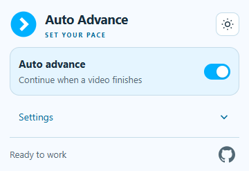
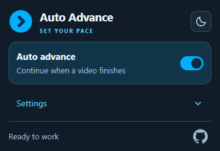
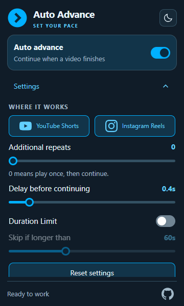
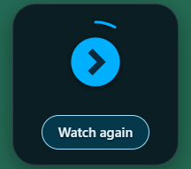

<p align="center"></p>

<h1 align="center">Auto Advance</h1>
<p align="center">Set your pace. Automatically move to the next YouTube Short or Instagram Reel.</p>
<p align="center"><a href="https://github.com/jhashubhamkr/auto-advance/releases">Download</a> · <a href="#install">Install</a> · <a href="PRIVACY.md">Privacy</a> · <a href="https://github.com/jhashubhamkr/auto-advance/issues">Report a bug</a></p>

A small Chrome extension with a simple on/off switch, optional repeats, and a moment to watch again before continuing. Settings save automatically and stay on your device.

**Initial public release · Manifest V3 · MIT licensed.** Install through Chrome's **Load unpacked** feature. A Chrome Web Store listing is not available yet.

## A compact popup, with settings when you need them

<p> </p>

- **Auto-next:** continue after a clip finishes.
- **Additional repeats:** watch once, or replay up to six extra times.
- **Watch again:** cancel the countdown and restart a full repeat cycle.
- **Duration limit:** optionally skip videos longer than your chosen threshold.
- **Ad skipping:** advance past recognized video ads using the same saved delay.
- **Per-site controls:** enable YouTube Shorts and Instagram Reels independently.
- **Light and dark themes**, accessible controls, and reduced-motion support.
- **Only the visible tab advances.** The toolbar turns blue on supported routes and gray elsewhere.

## Tune the pace

<p> </p>

The popup screenshots show the real extension UI. The countdown image uses a local test video, not a user's feed or account.

| Setting | Default | Available values |
| --- | --- | --- |
| Auto advance | On | On / off |
| Additional repeats | 0 | 0–6 extra playbacks |
| Delay before continuing | 0.4 seconds | 0.1–3 seconds |
| Duration Limit | Off | Skip if longer than 30–120 seconds; threshold starts at 60 |
| YouTube / Instagram | Both on | Independent switches |

**Repeats count extra plays:** 0 plays once, 1 plays twice, 2 plays three times. Every control autosaves; **Reset settings** restores playback defaults while keeping your theme.

When a countdown appears, **Watch again** restarts the current video and resets its count. If Duration Limit triggered the skip, a deliberate replay also bypasses that limit for the current video. Recognized ads show **Skipping Ad** and use the same delay.

## Install

1. Download `auto-advance-0.1.0.zip` from [Releases](https://github.com/jhashubhamkr/auto-advance/releases), then extract it into a permanent folder. You can also clone this repository or extract GitHub's source ZIP.
2. Open `chrome://extensions` and enable **Developer mode**.
3. Choose **Load unpacked** and select the folder containing `manifest.json`. Select the extracted folder, not the ZIP or its parent.
4. Open or refresh a YouTube Shorts or Instagram Reels tab.
5. Pin **Auto Advance** from Chrome's extensions menu. Use its main switch to enable or pause automation.

No Node.js, npm, build step, account, or server is required to use the extension.

**Updating:** replace the extracted files, click **Reload** on the extension card, and refresh existing Shorts/Reels tabs. Keeping the same folder helps preserve the unpacked installation and its settings.

## Where it works

| Site | Supported desktop pages |
| --- | --- |
| YouTube | `/shorts/{id}` |
| Instagram | `/reels/`, `/reel/{id}/`, `/reels/{id}/`, and Reel dialogs on those routes |

The bare and `www` HTTPS domains are supported. Normal YouTube videos, Instagram posts/stories, profile-grid videos, and mobile subdomains are outside the current scope.

YouTube and Instagram change their layouts regularly. Ad detection relies on recognized visible labels and ad components; it is **not a network ad blocker** and does not recognize every ad or language. Unknown layouts can require manual navigation. The extension does not click advertiser links.

Browser fixtures and real local media are tested automatically. They do not guarantee compatibility with every live account, experiment, or layout. See the [manual test checklist](TESTING.md).

## Privacy and permissions

No analytics, telemetry, cloud service, or account. Preferences use `chrome.storage.local`, not Chrome Sync. Playback counters live only in page memory.

- **Storage:** remember your preferences.
- **YouTube and Instagram host access:** inspect the active video and supported route, update the toolbar, and operate next-video controls. Access covers the site domains so same-page navigation into Shorts/Reels works without a reload.

The extension does not request cookies, history, password access, or the broad `tabs` permission. Site requests continue normally. The GitHub link opens this repository only when clicked. Read the [privacy policy](PRIVACY.md).

Debug logs are **off by default**. Concise operational warnings remain available when something fails. [Troubleshooting](DEBUGGING.md) explains how to temporarily enable diagnostics.

## Development

Use a current Node.js LTS release (Node 24 is used in CI).

```sh
npm ci
npm test
npm run check
npx playwright install chromium
npm run test:browser
npm run test:extension
npm run test:countdown
npm run package
```

Linux browser dependencies can be installed with `npx playwright install --with-deps chromium`. If your browser does not support the extension-loading test API, use a current Chrome build through `CHROME_PATH`.

`npm run package` creates the distributable ZIP and its SHA-256 checksum in `dist/`. Packaging includes only runtime files and licenses; docs, screenshots, tests, browser profiles and development dependencies are excluded. `npm run icons` regenerates the selected circled-chevron SVG/PNG variants using the development Playwright runtime.

The extension uses plain JavaScript, HTML and CSS. There is no bundler or production dependency.

| Folder | Purpose |
| --- | --- |
| `content/` | Settings, video monitoring, site adapters, countdown and controller |
| `popup/` | Popup UI and autosave |
| `icons/` | Selected logo variants and licensed service icons |
| `tests/`, `scripts/` | Regression tests, browser fixtures and packaging |
| `docs/images/` | Reviewed public README screenshots |

Contributions are welcome. Read [CONTRIBUTING.md](CONTRIBUTING.md), [SECURITY.md](SECURITY.md), and the [release guide](RELEASING.md).

## License and attribution

[MIT](LICENSE). YouTube, Instagram and GitHub brand SVGs are from Simple Icons; source and license information is in [icons/brands](icons/brands/README.md).

Auto Advance is an independent project, not affiliated with YouTube, Google, Instagram or Meta.
